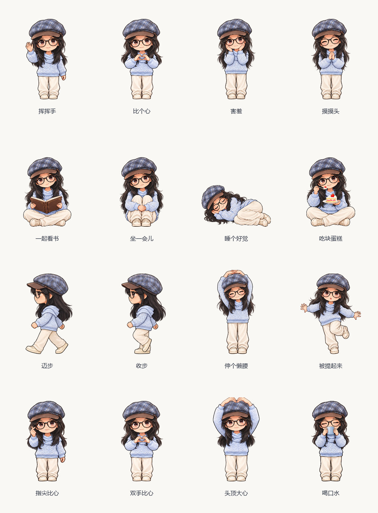

# 小薛同学桌宠

一个轻量、安静的 Windows 动漫桌面伙伴。工作时陪你看书，休息时挥手、比心，适时提醒喝水和走动；进入全屏、游戏或会议等场景时自动避让。

**v1.0.5 · Windows 10/11 x64 · 默认离线陪伴 · 无需安装 Python**

[下载安装包](https://github.com/yyt-serendipity/xiaoxue-pet/releases/download/v1.0.5/XiaoxuePet-1.0.5-Setup.exe) · [免安装版](https://github.com/yyt-serendipity/xiaoxue-pet/releases/download/v1.0.5/XiaoxuePet-1.0.5-Windows-x64.zip) · [全部下载与校验](https://github.com/yyt-serendipity/xiaoxue-pet/releases/tag/v1.0.5) · [使用指南](docs/USER_GUIDE.md)



## 她能陪你做什么

| 日常陪伴 | 使用方式 |
|---|---|
| 挥手、喝水、三种比心 | 双击人物打开快捷条，进入小屋选择动作 |
| 一起看书 | 点击即开始 30 分钟专注，重复点击不会重新计时 |
| 喝水、走动、放松眼睛 | 默认每 45 分钟轮换提醒，专注与安静状态暂缓 |
| 坐一会儿、睡觉、吃蛋糕 | 12 个陪伴入口，没有需要照顾的状态仪表 |
| 散步、跟随、停靠 | 支持拖拽、穿透、置顶、托盘与可选开机启动 |
| 游戏和工作时少打扰 | 支持全屏、演示、锁屏及指定前台游戏/会议软件的自动避让，也可手动隐藏 |

普通陪伴不需要 API Key。可选 DeepSeek Key 用于文字聊天，天气由用户手动触发。没有 QQ 监听、后台硬件监控或常驻 AI 模型。

## 慢一点，自然一点

当前默认 **舒缓 0.75×**，相比 1× 慢 25%。挥手约 **4.1 秒**，三种比心各约 **4.8 秒**；走路、呼吸、轻跳与摆动同步调整。眨眼、专注与提醒按自然时间运行。

<p>
  
  
</p>

以上为实际 Qt 控件的离屏动画预览。完整人物帧配合轻微整体运动，没有把手脚拆成分层骨骼；局部遮挡与补帧重影仍有改善空间。看书、睡觉等姿势不代表都有连续原画动画。

已有用户升级后会保留原速度，请在 **小屋 → 设置 → 动作节奏** 选择舒缓档。也保留 1×、1.5×、2×。

下载源码后，可在本机浏览器打开 [速度对比页](docs/tempo/index.html)。GitHub 文件页只展示 HTML 源码，不会直接运行预览。

## 简单的小屋

双击人物打开快捷条；小屋只有陪伴动作和设置。没有心情、精力、饱腹仪表，也没有复杂的喂饭页面。


更多当前版本的角色视图、动作设计和实际界面见 [产品设计展示](docs/DESIGN_GALLERY.md)。

## 安装与启动

1. 从 [Release](https://github.com/yyt-serendipity/xiaoxue-pet/releases/tag/v1.0.5) 下载 `XiaoxuePet-1.0.5-Setup.exe`。
2. 选择安装位置，例如 `D:\Apps\XiaoxuePet`，可创建桌面快捷方式。
3. 启动「小薛同学桌宠」。右键人物或托盘图标可打开完整菜单、隐藏或退出。


默认安装位置为 `%LOCALAPPDATA%\Programs\XiaoxuePet`。个人设置独立保存在 `%LOCALAPPDATA%\XiaoxuePet`，升级和卸载保留设置。升级前先从托盘退出旧程序；从早期源码版迁移时，先退出旧版并关闭旧的开机启动入口，避免运行两份。详见 [安装与迁移](docs/INSTALLATION.md)。

免安装版请完整解压，保留 `_internal` 文件夹，再运行 `XiaoxuePet.exe`。当前安装包未签名，可用 Release 附带的 `SHA256SUMS.txt` 校验文件。

## 轻量设计与实际边界

- 运行素材仅 **119 / 187 / 238 像素**三档；精细原画用于制作和展示。
- 动画按需读取相邻两帧，非当前动作释放；混合图像缓存上限 **2 MiB**。
- 活跃约 20ms、可见待机约 33ms、睡觉 100ms、隐藏 1000ms 调度；隐藏约 5 秒后释放素材。
- 放慢动作不降低刷新频率，不增加人物图片或缓存；运行时不使用 OpenCV、NumPy 或 AI 补帧模型。

缓存上限不是进程总内存。当前 187 像素离屏控件探针的工作集抽样约 **54–57 MiB**；它不包含完整桌面使用场景，不代表峰值内存或游戏帧率保证。前台避让是规则检测，不能识别所有后台录屏/会议，必要时可手动隐藏。

实现和测量范围见 [维护说明](docs/MAINTENANCE.md)、[整体动效](docs/BODY_MOTION.md) 和 [速度探针数据](docs/tempo/measurement.json)。

## 把你的人物做成桌宠

附带独立的 **xiaoxue-pet Codex skill**，包含代码模板、素材检查、预览和 Windows 打包流程。

1. 下载 [xiaoxue-pet-skill.zip](https://github.com/yyt-serendipity/xiaoxue-pet/releases/download/v1.0.5/xiaoxue-pet-skill.zip)。
2. 将 `xiaoxue-pet` 文件夹放到 `~/.codex/skills/`，新开一个 Codex 会话。
3. 上传人物照片，说明目标人物，例如：

```text
使用 $xiaoxue-pet，把上传照片中戴眼镜的人物做成精细动漫桌宠。
保持人物和服装一致，包含走路、眨眼、挥手、喝水和三种比心。
给我动作预览，以及独立的 Windows 桌宠安装包。
```

需要支持图像生成的 Codex 环境；EXE 需要 Windows 构建环境。skill 是制作工具，不是安装版内的照片上传功能，也不会作为后台服务运行。生成结果仍需检查人物一致性和动作质量。详见 [照片制作桌宠](docs/PHOTO_SKILL.md)。

## 源码运行与维护

推荐 Python 3.12 x64。已包含预处理素材，普通运行不必重新生成图片。

```powershell
python -m venv .venv
.\.venv\Scripts\python.exe -m pip install -r requirements-lock.txt
.\.venv\Scripts\python.exe main.py
```

测试和构建：

```powershell
.\.venv\Scripts\python.exe -m unittest discover -p "test_*.py" -q
.\.venv\Scripts\python.exe -m pip install -r requirements-build.txt
.\.venv\Scripts\python.exe scripts/build_release.py
.\.venv\Scripts\python.exe scripts/verify_release.py
```

v1.0.5 通过 41 项测试及安装、升级、卸载与冻结程序启动验证。验证范围见 [发布核验记录](docs/release-validation.json)，构建说明见 [打包与发布](docs/RELEASE.md)。

## 隐私、来源与许可

仓库不含真人原始照片、API Key、个人运行配置、聊天记录或联系人信息。可选 Key 当前明文保存在本机 JSON，请勿分享配置文件。详见 [隐私说明](docs/PRIVACY.md)。

「小薛同学桌宠」是独立维护的项目；窗口、托盘及部分基础能力基于 MIT 许可的 [1190fasheqi/dafeiyu-pet](https://github.com/1190fasheqi/dafeiyu-pet) 改造，不是上游官方版本。代码遵循 [MIT License](LICENSE)，依赖和人物素材说明见 [第三方许可](THIRD_PARTY_NOTICES.md)。
