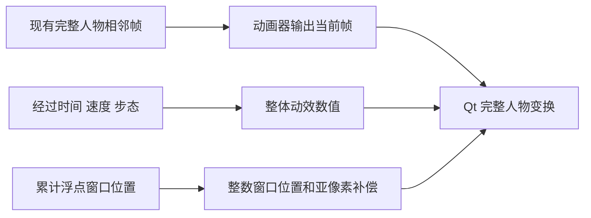

# 借鉴大肥鱼的整体动效

当前版在完整人物帧之外加入了连续整体动效：呼吸、行走起伏、起停缓和、跳跃，以及窗口移动的小数位累计。没有拆分手脚，没有增加动画图片，没有运行时光流或 AI 推理。

[打开整体动效机制对比](body-motion/index.html)。这是实际 Qt 控件的离屏渲染，分别展示待机、走路起停和跳跃；固定镜头不展示桌面窗口位移，也不是原大肥鱼软件录屏。

## 当前动作节奏

默认 0.75×，以统一速度参数控制挥手、比心、喝水、行走、呼吸与轻跳。整体相位累计经过时间，切换速度不会直接跳到另一个呼吸相位；步态仍按真实位移推进，避免重复乘速度。眨眼使用自然短时闭合，30 分钟专注及提醒仍按真实时间计时。

[查看当前版 1× / 0.75× 实际控件对比](tempo/index.html)。下方整体机制对比保留固定参数实验数据，用于解释实现；不能把它当作当前默认节奏。

## 查到了什么

目标是 [1190fasheqi/dafeiyu-pet](https://github.com/1190fasheqi/dafeiyu-pet)，即 DeepSeek 二创「鲸鱼娘·大肥鱼」。检查的提交是 `5b0e01856116bd2bae82df1f43c32faa5f056196`，与本机原始 Git 提交一致。GitHub 的 releases 列表在检查时为空；本机保存的原快捷方式也是直接启动 Python 源码。

依照 REA 技能的目标分流规则，完整开源代码应直接审阅。本次没有调用 REA MCP/CLI 引擎、安装反编译工具或修改 MCP 配置；证据属于源码观察和本项目离屏验证，不是二进制反编译结果。身份、摘要和范围记录见 [source-evidence.json](motion-research/source-evidence.json)。

从原版 [paintEvent](https://github.com/1190fasheqi/dafeiyu-pet/blob/5b0e01856116bd2bae82df1f43c32faa5f056196/%E6%A1%8C%E5%AE%A0.py#L517) 和 [tick](https://github.com/1190fasheqi/dafeiyu-pet/blob/5b0e01856116bd2bae82df1f43c32faa5f056196/%E6%A1%8C%E5%AE%A0.py#L618) 可直接确认：

| 源码观察 | 对流畅感的作用 |
|---|---|
| 三张人物视图，20ms 定时绘制 | 不依赖大量肢体原画 |
| 行走旋转 `sin(t×9)×3.5°` | 整个人物连续摆动 |
| 行走起伏 `−abs(sin(t×4.5))×7px` | 营造轻快步伐 |
| 呼吸缩放 `1 + 0.02×sin(t×2.5)` | 停下后仍有轻微变化 |
| 跳跃、转向淡化、速度惯性 | 避免只剩固定姿势的移动 |

“这些连续变换有助于流畅感”是基于实现的解释，不是对原版实测 FPS 的结论。原版的三视图方案也不能证明连续挥手、手指比心会自然。

## 本项目采用的实现

`body_motion.py` 仅返回完整人物的旋转、起伏及横纵缩放数值。Qt 对整张当前帧变换后绘制，不生成或缓存另一套身体图片。

- **行走起停**：用与经过时间相关的指数包络逐渐进入或退出步态；停下后沿最后的步态缓和收住，避免起伏瞬间归零。横向行走与动画步态同步，纵向移动也保留整体起伏。
- **呼吸与跳跃**：微幅纵向呼吸，减少整个人物均匀放大缩小的感觉；跳跃使用平方正弦，让起跳和落地处的垂直速度趋近零。读书、睡觉、手势动作使用更小的整体摆动。
- **亚像素位置**：`desktop_geometry.MotionPosition` 保存浮点位置，窗口仍移动到整数坐标，但绘制时补偿不足一像素的差值。拖拽、停靠等外部移动会重新对齐，不把旧位置拉回来。
- **调度**：活跃仍约 20ms；可见待机从 50ms 调整为 33ms；睡觉 100ms、隐藏 1000ms。可见非睡眠状态使用精确定时器，隐藏与睡觉使用低频粗定时器，没有全局高频计时线程。

## 验证与开销边界

两个人物版本各通过 41 项测试，包括起停连续性、包络对回调频率的独立性、跳跃端点、小数位累计、外部拖拽后的重对齐，以及睡觉/隐藏调度。原有两帧源图上限、2MiB 混合缓存和隐藏释放仍保留。

本目录的 [调整前](body-motion/before.json) 与 [当前版](body-motion/after.json) 记录了 187 像素下真实 Qt 控件抓帧耗时和工作集快照。每种场景模拟 3.2 秒，截图编码在计时和内存取样之后。探针排除了真实 Windows 合成器、前台场景检测、网络与游戏，不是完整使用状态的内存峰值或游戏帧率测试。

固定参数探针的单次离屏绘制 P95 约 1.5ms，探针工作集约 54–57MiB；两版本抽样数量不同，不应把 P95 的降低解释成总 CPU 更低。可见待机的绘制次数增加了，确有 CPU 成本；隐藏和游戏避让仍走低频路径。新增的运行时状态只是少量数值，没有新增角色帧资源。

复测可使用 `scripts/compare_body_motion.py --baseline <本地保存的原桌宠.py>`。该脚本会使用当前同一套素材、临时设置和离屏窗口，避免读取私人配置；旧代码备份不随公开包分发。

## 仍未解决的部分

这次改善的是整体运动感和坐标连续性。挥手、比心、交叉脚步的局部重影及人物原画差异仍受原画与离线补帧限制，没有被宣称修好。追求更自然的手部动作，需要补画更一致的过渡原画，而不是继续加大身体摇摆或刷新频率。
