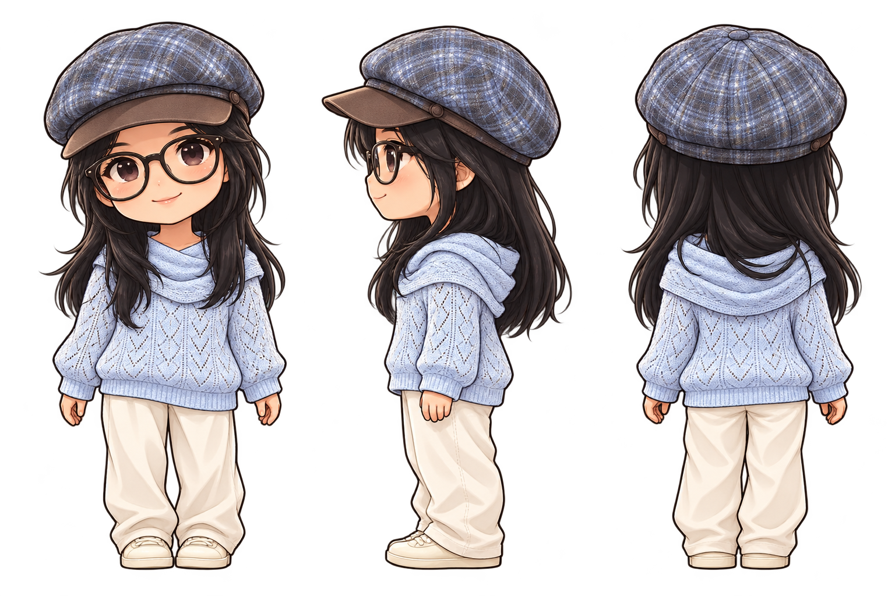
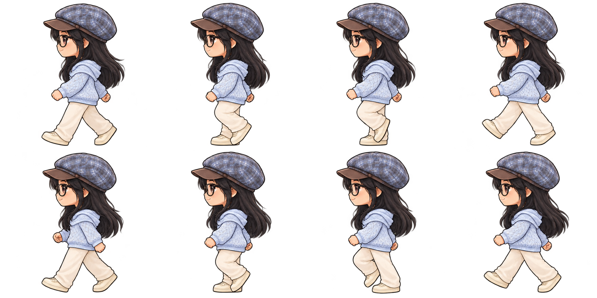
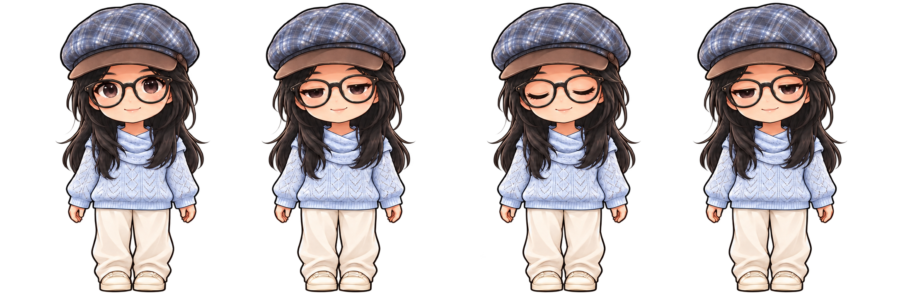
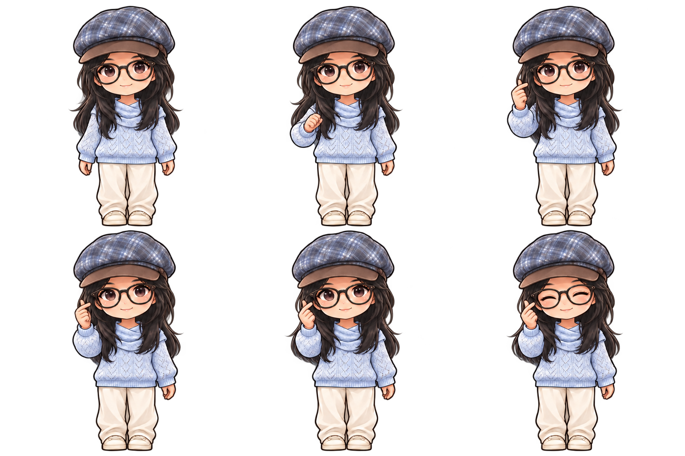
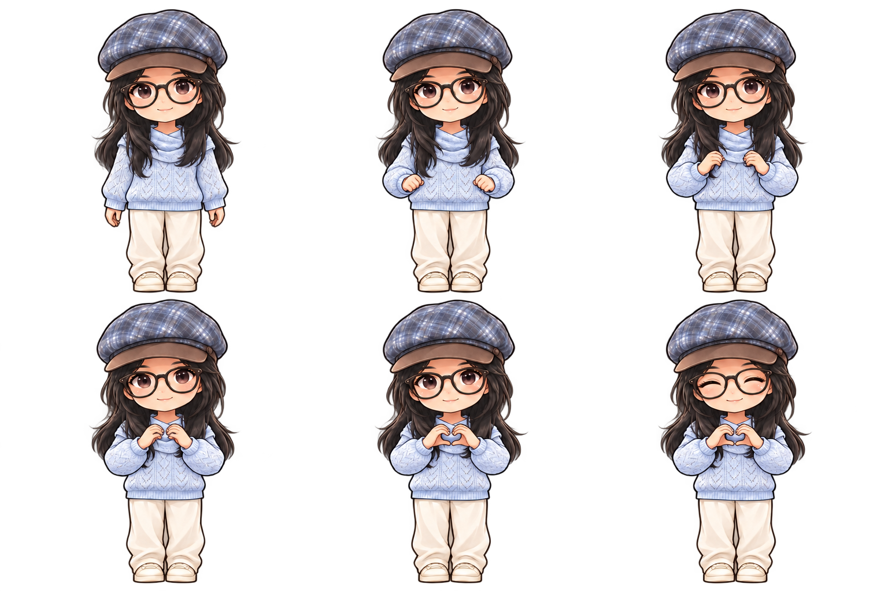
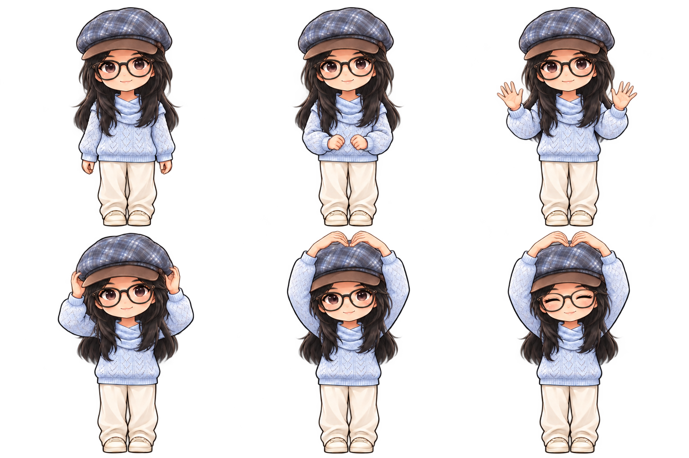
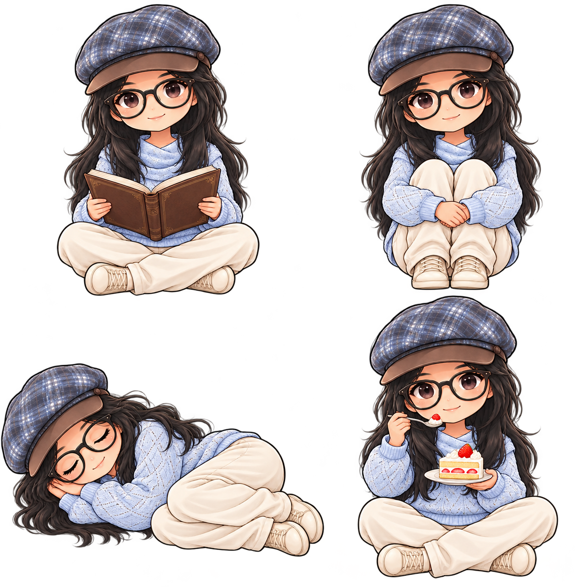
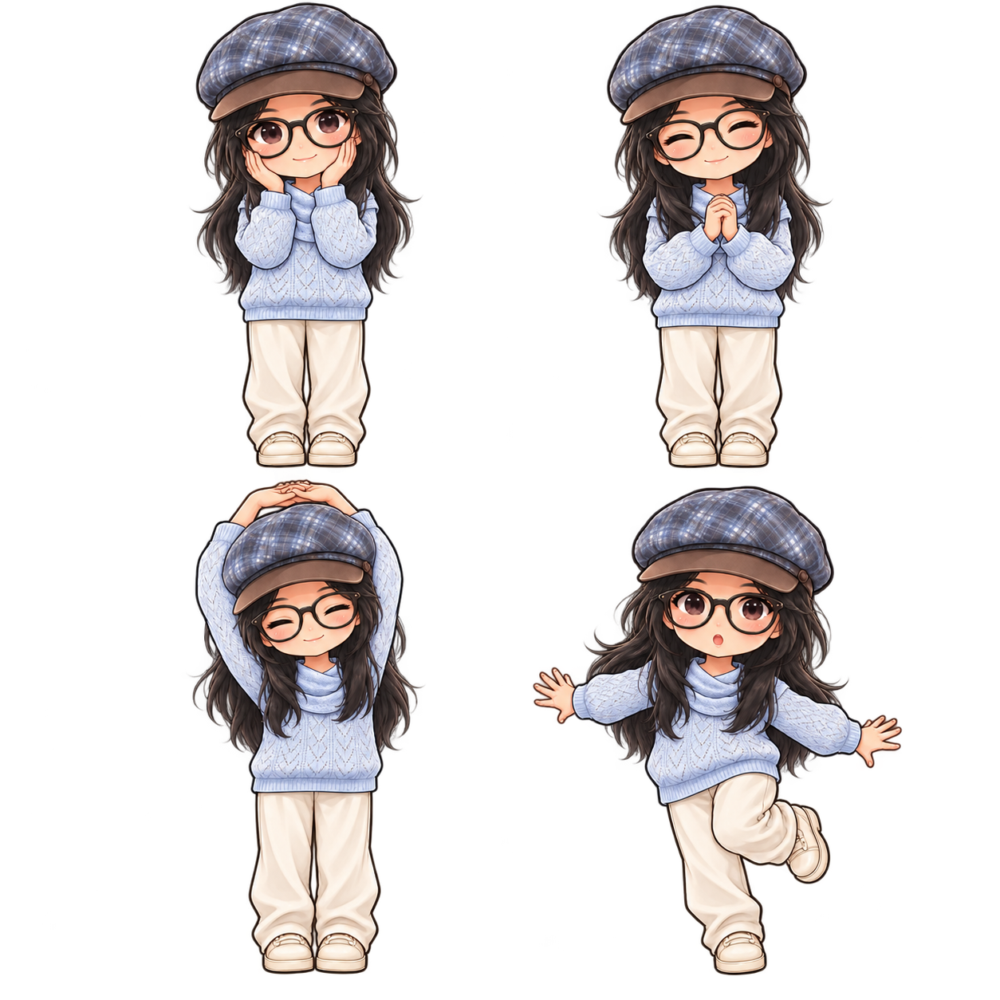
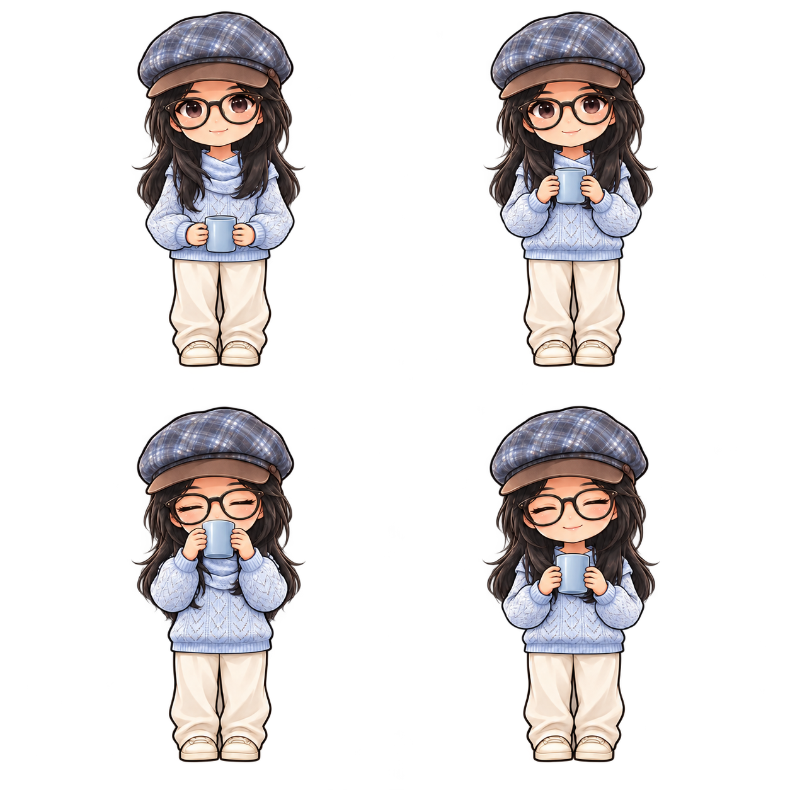

# 小薛同学桌宠 · 产品与设计展示

**安静陪伴，适时回应，专注时退到后台。**

小薛同学不是需要反复喂养的数值养成游戏。她用动作、简短话语和可关闭的提醒陪伴日常，尽量减少额外操作。
名字取「晓」的晨光与「雪」的柔和；视觉以蓝灰帽子、浅蓝针织衣和米色长裤构成统一形象。

## 当前形象

以下是人物设计原画，不是运行时全尺寸加载的图。

正面、侧面、背面用于保持帽子、发型、服装与轮廓一致。
当前动作精细度统一按下面这组挥手原画：

人物应在做不同动作时仍像同一个角色。重点保留脸型、眼镜比例、帽子格纹、细发丝和针织纹理。

## 连续动作

### 走路、眨眼与挥手

走路使用连续姿势；眨眼保留稳定身体，避免整个人跟着跳动。
挥手有抬手、摆手、落手过程，而不是无限重复两个姿势。

### 三种比心

每种比心在陪伴页都有独立入口。下方为制作原画；运行时先缩小并生成过渡帧。

采样帧用于检查抬手、停留、收手和人物比例。二维补帧仍可能有局部残影，当前没有实时骨骼动画。

### 日常陪伴

看书承担简单的 30 分钟专注；喝水和伸懒腰呼应用户自己的日常休息。
吃蛋糕保留单一动作，避免引入多层菜单与维护负担。

## 当前界面：把动作放在前面

以下均为当前版本实际 Qt 控件截图，使用临时空配置拍摄。

双击即出现六个常用入口。更完整的动作放进陪伴页，三种比心直接展开。

 

没有心情/精力/饱腹仪表，没有底部计时文字，也没有大型外框和关闭按钮。
点击外部或 Esc 收起；设置集中管理大小、节奏、昵称、提醒与避让。

安装包、程序名和默认昵称统一使用小薛同学，不借用上游项目的名称和图标。

## 设计图与运行资源的关系

源码仓库保存当前版本的精细原画、截图和设计图；桌宠只读取预处理的小/中/大 PNG。
图更多主要增加源码包的磁盘体积，不会让程序把整个设计图库放进内存。
没有公开真人原始照片、聊天内容、联系人或密钥。
