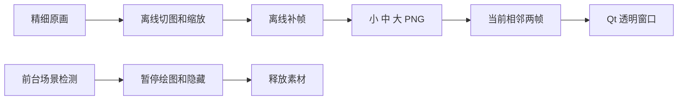
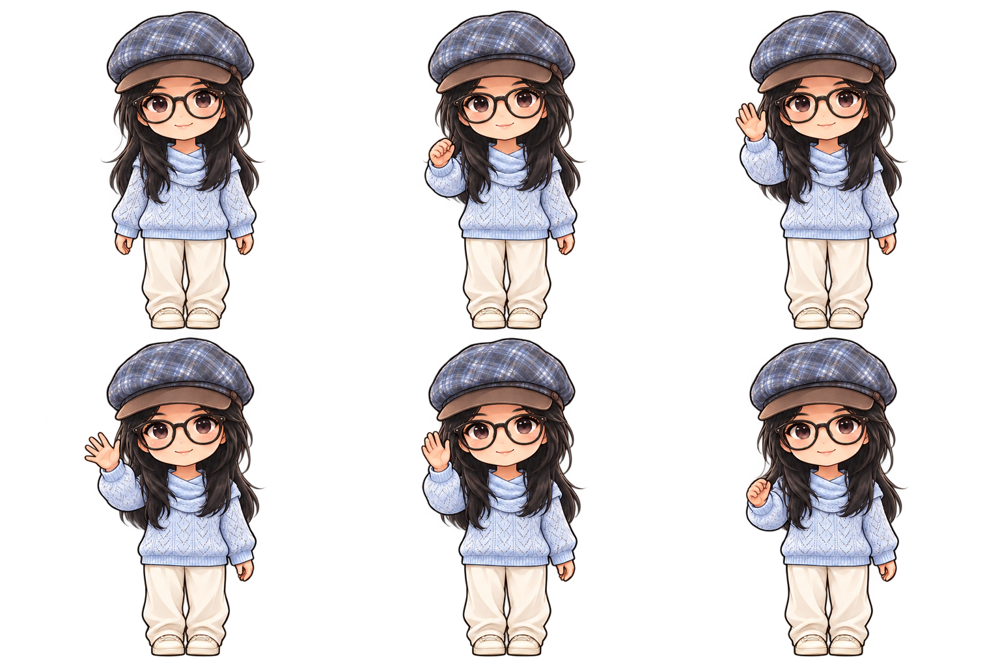
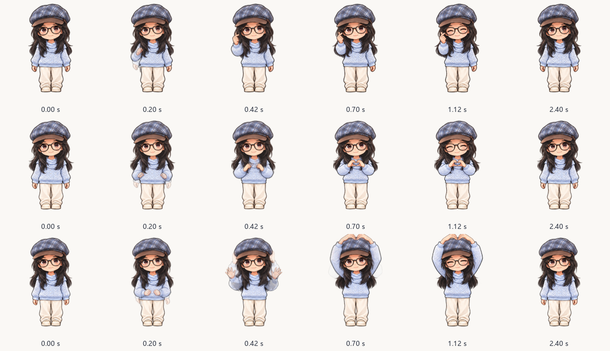

# 现有实现与维护说明

本文说明当前结构和关键约束，不包含从零制作教程。

## 模块

| 文件 | 职责 |
|---|---|
| main.py / 桌宠.py | 入口、透明窗口、鼠标、托盘与调度 |
| companion.py | 陪伴状态、专注、动作与设置 |
| companion_lines.py | 陪伴/提醒话语 |
| animation.py | 时间采样、相邻帧、过渡与缓存 |
| body_motion.py | 整体呼吸、起伏、跳跃的连续变换与调度档位 |
| sprite_store.py | 当前尺寸静态图与缩略图 |
| game_guard.py | 通知状态、全屏、前台应用规则 |
| desktop_geometry.py | 多屏边界、移动、停靠 |
| app_paths.py | 安装版与源码版配置路径 |
| prepare_assets.py | 素材重建入口 |
| prepare_unified_art.py | 精细画风完整人物切图、对齐、缩放 |
| build_heart_motion.py / build_action_motion.py | 仅构建时补帧：比心、走路、挥手、喝水 |
| scripts/build_release.py / scripts/export_source.py | 构建安装版与免安装版，白名单导出源码和 skill |



## 风格与动画



同一人物的脸型、黑框眼镜、格纹帽、黑色长发、浅蓝针织衣、米色长裤保持一致。
每帧是完整人物，未采用实时肢体分层或骨骼拼接。
精细源图只存磁盘，不能直接拿来运行。



三种比心每种六个主要关键姿势，离线构建 41 张磁盘帧；收手反向播放。
默认 0.75 倍节奏约 4.8 秒。光流处理不在桌宠运行时执行。
二维补帧仍可能有局部残影，不等同于手工逐帧或三维动画。

走路、挥手、喝水现在也有离线中间帧，运行器按动作清单解析并正向/反向播放。具体路径、缓存机制和测量见 [连续动作实现](MOTION.md)。

完整人物帧绘制时再叠加轻微整体变换；窗口位移保留小数并在画面中补偿。源码依据、实现和边界见 [整体动效](BODY_MOTION.md)。

## 轻量约束

- 119/187/238 三档；306 仅作构建中间尺寸。
- 走路、挥手、额外动作最多两张源帧驻留，非当前动作释放。
- 混合缓存上限 2 MiB，静态图只保留当前尺寸。
- 活跃约 20ms、可见待机 33ms、睡觉 100ms、隐藏 1000ms 调度。
- 隐藏约 5 秒释放素材。运行时不导入 OpenCV/NumPy，无硬件监控轮询。

测量应区分工作集、私有内存、启动/静止/动作/隐藏状态；缓存数值不是整个程序内存。

## 修改后的验证

普通使用不需重建，更新原画后才执行：

```powershell
.\.venv\Scripts\python.exe -m pip install --target .asset-build-tools -r asset-build-requirements.txt
.\.venv\Scripts\python.exe prepare_assets.py
.\.venv\Scripts\python.exe -m unittest discover -p "test_*.py" -q
```

检查每种大小、人物一致性、透明边缘、脚底、抬手与收手、菜单缩略图。
不要将废弃 QQ、旧大尺寸、分层实验和私人参考照片重新打包。
截图必须来自实际控件/窗口；原画、帧表应明确称为素材或预览，不冒充功能截图。

## 边界

自动避让是前台状态规则，不是屏幕内容识别，不能覆盖所有后台录屏/会议。
保留手动隐藏。当前无 QQ、喂食菜单、复杂番茄钟页面、运行时换装。
