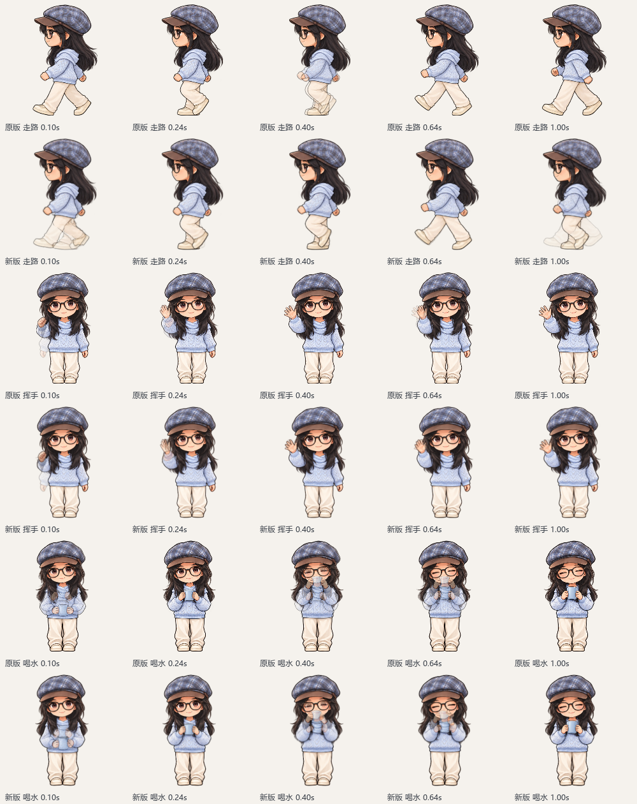
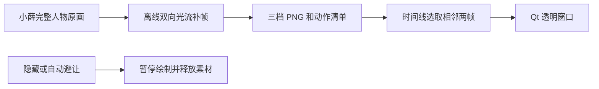

# 连续动作如何实现

当前 1.0.5 已将走路、挥手、喝水接入离线中间帧播放。沿用小薛自己的完整人物原画和三档尺寸，不拆分胳膊、手掌或身体，也不在运行时计算光流。三种比心保留现有 41 帧流程；眨眼及其他姿势没有重新绘制。

[打开实际动画器的前后对比](motion-comparison/index.html)。本页图片是渲染帧对照，不是桌面实拍。



## 原因与改动

原播放逻辑在每段走路过渡的前 80% 保持同一张图，只在最后 20% 混合下一张。即使调度每 20ms 运行一次，大部分时间也没有新画面。挥手和喝水的主要姿势较少，两张差异较大的图直接淡入淡出容易出现双手、双杯子的重影。

当前版本采用以下过程：

1. `prepare_assets.py` 从小薛原画切出完整人物、对齐并生成制作尺寸。
2. `build_action_motion.py` 在制作阶段用 OpenCV DIS 光流估计相邻姿势的双向位移。两端图像按位移变形后混合，透明像素采用预乘 alpha，避免直接混合透明底产生黑边。
3. 每条关键姿势路径分成 8 个区间，保存包含两端的 9 张完整人物 PNG；不同路径的公共端点可能重复保存。
4. 输出缩小到 119 / 187 / 238 像素的动作帧及 `manifest.json`，306 像素只作制作中间尺寸。
5. `animation.py` 的 `MotionBank` 把原动作时间线的“姿势 A → 姿势 B，进度 t”换算为中间帧位置，再读取相邻两帧做小幅混合。收手沿同一路径反向播放。

| 动作 | 原关键姿势数 | 保存的路径数 | 每档磁盘帧数 |
|---|---:|---:|---:|
| 走路 | 8 | 8，包括末帧回到首帧 | 72 |
| 挥手 | 6 | 6，包括肩前收回胸前 | 54 |
| 喝水 | 4 | 3，放杯时反放 | 27 |

这些数字包含端点重复帧，不代表重新绘制了同等数量的独立原画。



## 连贯播放与开销

走路使用连续进度，取消前 80% 停帧。离线中间帧之间使用线性进度，避免每到一张细分帧又缓入、缓出一次。挥手/喝水继续沿用抬手、动作到位、停留、收手的原时间线；停留不应被误判为掉帧。走路相位由经过时间、速度和人物尺寸推进，不按回调次数硬加一帧。

活跃时仍是约 20ms 的调度目标，没有改成更高频率。50Hz 调度不保证每台电脑实际达到 50fps，也不意味着有 50 张新原画。动作切换仍使用短过渡，定时器延迟时按时间线选取当前应显示的画面。

`FramePair` 最多保留当前动作的两张源帧，混合缓存上限 2MiB；非当前动作释放，静态图仅保留当前尺寸。大档两张源帧约 0.454MiB，但这不是整个程序的内存。隐藏时暂停绘制、约 5 秒后释放素材；自动避让规则保持原有实现。

新增图片主要增加安装包和磁盘体积，读取、解码与混合仍有成本。运行包包含动作清单与三档 PNG，不包含原始大图、306 制作尺寸、OpenCV 或 NumPy；没有后台 AI、QQ 监听或实时插帧线程。

## 本机验证

相同原画，238 像素、动作速度 1.5 倍、走路速度 100，每 20ms 采样，共 160 次/动作。在独立渲染进程中比较：

| 指标 | 原播放逻辑 | 当前播放逻辑 |
|---|---:|---:|
| 走路相邻重复画面 / 159 次比较 | 119 | 0 |
| 挥手相邻重复画面 / 159 次比较 | 81 | 78 |
| 喝水相邻重复画面 / 159 次比较 | 87 | 82 |
| 三种动作渲染耗时 P95 | 0.714ms | 1.555ms |

挥手和喝水结束后本来就会停留，重复数不应追求归零；空间过渡效果应看动画。测试中逐次检查两帧上限与 2MiB 缓存，确认运行器没有导入 OpenCV/NumPy。探针结束并释放动画器后的工作集快照约 46MiB，不能当作完整桌宠活跃/峰值内存，也没有测量游戏 FPS。

原始结果：[修改前](motion-comparison/before.json)、[当前版](motion-comparison/after.json)。38 项测试、11 张原图及 970 张运行素材检查通过；完整安装包验证见交付目录的 `verification.json`。

## 后续维护

源码已包含运行素材，启动无需重新计算。更新原画后运行 `prepare_assets.py`，它会同时重建比心与三组动作帧；不要只替换 PNG 而漏掉动作清单。具体命令见 [维护说明](MAINTENANCE.md) 与 [打包说明](RELEASE.md)。

若要比较下一次修改，先自行保留修改前的 `animation.py`，再运行：

```powershell
.\.venv\Scripts\python.exe scripts/compare_motion.py --baseline "<本地备份的 animation.py>" --output docs/motion-comparison
```

该脚本使用同一套当前素材比较播放代码；不能用来单独归因两套不同原画的质量。输出 187 像素、20ms 间隔的 APNG，对比页面需要与旁边的 PNG 文件一起打开。暂停按钮切到静止预览，页面在后台时也切到静止预览。

二维光流不理解手指结构或前后遮挡。交叉脚步、杯子经过脸部、较大幅度抬臂仍可能模糊或重影；当前改善的是播放连续性，不能替代更多精细、统一的过渡原画。需要继续提高自然度时，应优先补画这些关键姿势。
