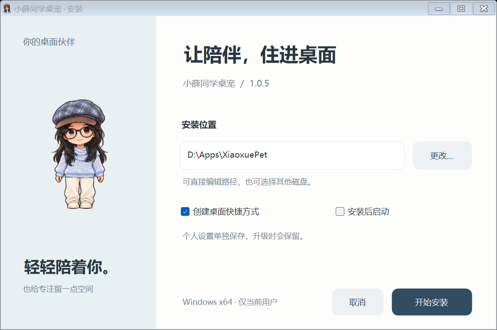

# 本地打包与 GitHub 发布

## 1. 准备构建环境

在 Windows x64、Python 3.12 环境执行。首次构建需要网络安装依赖；运行程序不需要构建工具。

```powershell
python -m venv .venv
.\.venv\Scripts\python.exe -m pip install -r requirements-lock.txt -r requirements-build.txt
.\.venv\Scripts\python.exe -m unittest discover -p "test_*.py" -q
```

当前打包使用 PyInstaller 6.22.0。官方说明：[目录模式与 spec](https://pyinstaller.org/en/stable/spec-files.html)。
采用目录模式，让 Qt DLL 保持独立，不需要每次运行解压到临时目录。
安装程序由 Windows 自带 .NET Framework 4.x C# 编译器构建；不需要安装额外安装器框架。

## 2. 生成程序和安装包

```powershell
.\.venv\Scripts\python.exe scripts/build_release.py
.\.venv\Scripts\python.exe scripts/verify_release.py
```

默认产物在 `.release/`：

| 文件 | 作用 |
|---|---|
| XiaoxuePet-1.0.5-Setup.exe | 当前用户安装版 |
| XiaoxuePet-1.0.5-Windows-x64.zip | 完整免安装目录 |
| app/XiaoxuePet/ | 未压缩程序目录 |
| verification.json | 安装/升级/卸载与冻结启动测试结果 |
| SHA256SUMS.txt | 安装包、免安装包校验值 |

默认安装到 `%LOCALAPPDATA%\Programs\XiaoxuePet`，可以在安装页直接编辑路径或点击「更改」选择其他本地磁盘。选择父文件夹时会建立 XiaoxuePet 专用子目录；输入框展示最终安装路径。默认位置通常不需要管理员权限，自定义位置需要当前账户有写入权限。

升级时自动读取已登记的原安装目录，避免重复安装；若要迁移位置，请先卸载旧程序再安装，个人设置会保留。设置仍独立保存到 `%LOCALAPPDATA%\XiaoxuePet`，不跟随安装目录移动。
安装程序会创建当前用户卸载入口和开始菜单快捷方式，可选桌面快捷方式。
升级前需要退出已运行的 EXE；不会自动强行结束用户进程。
卸载依据安装清单删除程序文件，保留用户新增文件和个人设置，不递归删除整个未知目录。



截图来自实际安装器控件，填写的是演示路径，没有执行安装。安装期间使用后台线程写入文件并显示进度，界面保持响应；完成前暂时禁用关闭，避免中断文件写入。

`verify_release.py` 在隔离目录运行安装包测试解压、冻结程序启动、再次覆盖安装和清单卸载。
它不修改真实注册表或快捷方式；这些系统集成仍应在正式分发前人工试用。
同时验证自定义中文/空格目录、拒绝相对路径和磁盘根目录、不覆盖已有无关文件，以及升级位置冲突提示。
测试不调用 AI、天气，也不向任何联系人发消息。

## 3. 导出可上传的源码目录

先生成截图，再导出到一个空目录：

```powershell
.\.venv\Scripts\python.exe scripts/capture_docs.py
.\.venv\Scripts\python.exe scripts/build_skill_template.py
.\.venv\Scripts\python.exe scripts/export_source.py "release-source/xiaoxue-pet"
```

导出工具使用白名单：只包含实际模块、测试、维护脚本、公开素材、截图、文档和 skill。
不复制 `.git` 历史、个人配置、API Key、原照片、日志、开发环境、联系人或旧备份。
生成独立 `Source.zip` 和 `xiaoxue-pet-skill.zip`；`PUBLICATION_MANIFEST.json` 列出内容和本地密钥扫描结果。
导出的目录可以直接作为一个新 GitHub 仓库，原开发目录不需要整体上传。

当前源码包含三档动作 PNG、对应 manifest.json、原画和动画对比。306 制作缓存不导出，可由 prepare_assets.py 重建；运行包必须携带动作清单，否则不能启用对应离线帧。skill 模板需要先重建，确保新照片项目也包含当前播放器和编译器。

## 4. 手动发布到自己的 GitHub

官方仓库为 [yyt-serendipity/xiaoxue-pet](https://github.com/yyt-serendipity/xiaoxue-pet)，安装包与 skill 通过 [Release](https://github.com/yyt-serendipity/xiaoxue-pet/releases) 分发。
维护者更新版本时，先检查截图、素材授权、README 和配置排除规则，再执行：

1. 在自己的 GitHub 账号创建独立仓库，建议仓库名 `xiaoxue-pet`。
2. 将导出的 `xiaoxue-pet/` 作为仓库根目录，初始化 Git 并提交；不用原开发目录的远程地址。
3. 保留 `LICENSE` 与 `THIRD_PARTY_NOTICES.md`，不把独立品牌表述为基础代码全部原创。
4. 创建版本标签和 Release，例如 `v1.0.5`。
5. 将 Setup.exe、Windows-x64.zip、skill.zip、SHA256SUMS.txt 作为 Release 附件；不要把 EXE 提交进 Git 历史。
6. 使用另一台机器下载、校验并试运行，再扩大发布范围。

## 5. 校验与常见打包问题

```powershell
Get-FileHash .\XiaoxuePet-1.0.5-Setup.exe -Algorithm SHA256
```

将结果与 SHA256SUMS.txt 对照。当前产物未签名，不建议通过关闭杀毒软件解决提示。

- **DLL 错误**：构建脚本隔离 PATH，避免拾取 Poppler/Conda 等软件的同名 DLL。Qt 6.12 使用 Windows 系统 ICU，不随包覆盖系统 ICU。参考 [Qt Windows 部署](https://doc.qt.io/qt-6/windows-deployment.html)。
- **设置写入失败**：确认使用当前 app_paths.py；不能把个人设置写进 `_internal`。
- **体积过大**：检查 spec，只带小/中/大和缩略图，不带原画、306 制作尺寸、NumPy、OpenCV、历史设计档案。
- **截图过时**：功能修改后重拍实际控件，再更新安装包和源码包。

## 6. 更新版本

修改 VERSION，并同步 Setup.cs 的显示/注册版本及文档文件名；重跑测试、构建、冻结启动验证和源码扫描。
不要将上一个版本的验证结果直接写成新版本已经通过。

## GitHub Windows 构建

仓库提供手动触发的 `Build Windows release` 工作流。它在干净的 Windows 环境中安装锁定依赖、运行测试、构建并验证安装包，然后上传到已存在的同版本草稿 Release。工作流不会自动公开草稿。

维护者先准备同版本草稿 Release，并附上 `START_HERE.md` 与 `RELEASE_NOTES.md`，再从 Actions 触发工作流。所有步骤成功后，检查附件与 SHA256SUMS.txt，再发布草稿。工作流仅使用 GitHub 自带的仓库令牌，不需要把私人 API Key 放进源码。
