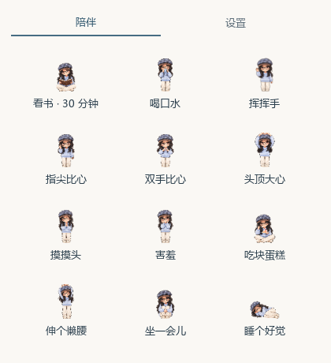
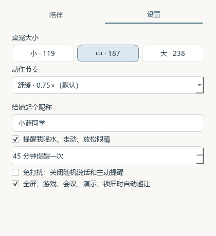

# 小薛同学桌宠使用指南

## 安装与首次启动

运行 `XiaoxuePet-1.0.5-Setup.exe`。默认安装到当前用户的 `%LOCALAPPDATA%\Programs\XiaoxuePet`。可直接编辑安装路径，或点击「更改」选择其他本地磁盘；选择父文件夹后自动建立 XiaoxuePet 专用子目录，请确认输入框中的最终位置。当前账户需要对所选目录有写入权限。

已安装时自动使用原目录升级。若要迁移位置，先卸载旧程序再选新位置安装；个人设置继续保存在原用户数据目录。
也可以完整解压免安装 ZIP，双击 `XiaoxuePet.exe`；不要删除旁边的 `_internal`。

首次使用不需要登录或 API Key。安装不会自动开启开机自启。

## 鼠标与托盘操作

| 操作 | 效果 |
|---|---|
| 按住拖动 | 移动人物 |
| 单击 | 互动并显示聊天/陪伴入口 |
| 双击 | 打开快捷条 |
| 右键人物或托盘 | 完整菜单、模式、大小、隐藏、穿透、退出等 |
| 点击面板外 / Esc | 收起快捷条或陪伴页 |

快捷条有摸头、比心、挥手、蛋糕、看书、小屋。快捷「比心」轮换变体；陪伴页可直接选择具体比心。

## 陪伴动作

- **看书**：开始 30 分钟专注，重复点击不会重置；完成时提醒。
- **喝水**：执行喝水动作。
- **三种比心**：指尖、胸前双手、头顶大心各自独立。
- **蛋糕**：当前只有蛋糕动作，没有喂饭菜单。
- **睡觉**：进入休息；右键动作中的起床/自由活动可以恢复，也可结束看书。

陪伴页没有状态仪表、底部计时文字或自由活动按钮。

## 设置与日常提醒

小/中/大为 119/187/238 像素，没有特大档。
动作节奏为 1/1.5/2 倍，默认 1.5 倍，不加快眨眼频率。
昵称编辑结束后保存。

日常提醒默认每 45 分钟轮换喝水、走动、放松眼睛，可以关闭或调整间隔。
专注、睡觉、免打扰、隐藏、自动避让时暂缓，不集中补发。
日常提醒显示气泡；专注完成可能使用托盘通知。

## 玩游戏和工作时

开启自动避让。检测结合 Windows 通知状态、前台程序和全屏客户区；普通最大化不会一律当作全屏。
内置前台游戏规则含 OW、CS2、Valorant、LoL、Dota2、Apex、PUBG，工作软件含腾讯会议、Zoom、Teams、OBS。
规则针对前台窗口，不因后台启动了游戏就一直隐藏。

后台录制、特殊演示软件、部分窗口模式可能识别不到，保留右键/托盘手动隐藏。
恢复有短暂延迟，避免切窗口时闪烁。

## 可选 AI 与天气

右键设置自己的 DeepSeek Key 后使用聊天；不设置仍能正常陪伴。
右键设置城市并手动查看天气。
两项功能需要网络；API 消费由使用者承担。不要分享 `config.json`。
Key 目前只启用文字对话，不解锁语音、自动生成动作或 QQ 功能；提醒、专注、现有动画和避让均不依赖 Key。

## 退出、卸载和排障

选择右键菜单「退出」保存状态并结束进程；收起面板不等于退出。
安装版可通过 Windows 已安装应用或安装目录的 `Uninstall.exe` 卸载。
卸载保留 `%LOCALAPPDATA%\XiaoxuePet\` 的个人设置；不需要时可自行删除这一明确目录。

| 现象 | 处理 |
|---|---|
| 人物不见了 | 看托盘显示/隐藏，检查是否正在避让 |
| 点不到人物 | 托盘关闭鼠标穿透 |
| 缺 DLL 或 PNG | 重新完整解压，保留 EXE 与 _internal 的目录关系 |
| 动作慢 | 设置节奏为 1.5 或 2 倍 |
| 聊天不可用 | 检查 Key、网络和余额；普通陪伴不受影响 |
| 未知发布者 | 当前包未签名；核验来源及 SHA-256，不关闭防护 |

报告问题附系统版本、复现步骤、大小档位与截图，不附私人配置。

## 动作节奏

设置中默认「舒缓 · 0.75×」，也可选择 1×、1.5×、2×。已有配置沿用原选择，升级后请手动选择舒缓档。这个设置控制动作速度，不降低绘制帧率；看书仍是 30 分钟。
